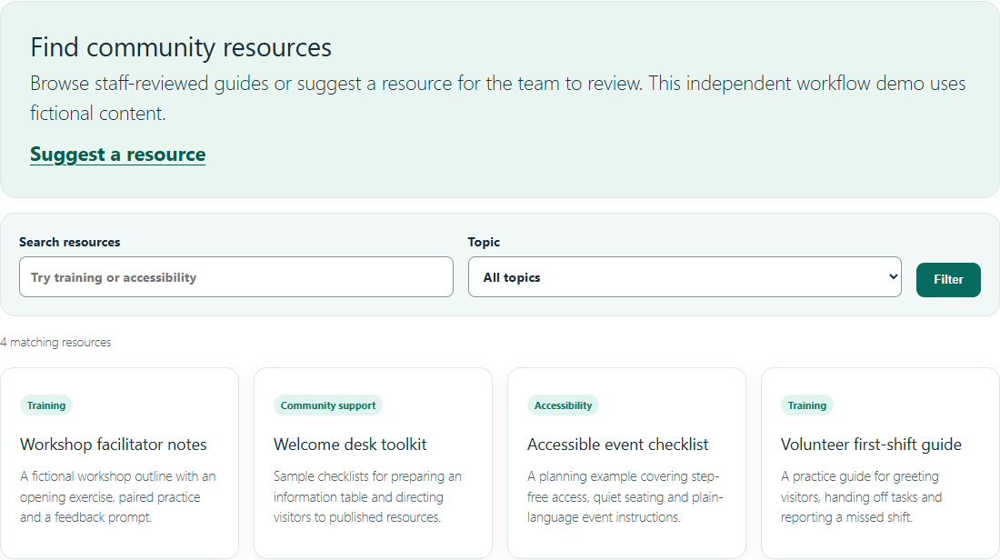

# Community Resource Hub

**Independent WordPress workflow demo using fictional content.** A community team can maintain a searchable directory and review public suggestions in WordPress before adding them to the directory.

- **Find useful guides.** Search published resources by keyword, narrow by topic, and clear filters from the same page.
- **Collect suggestions.** An anonymous visitor can suggest a fictional resource and receive a confirmation that it is pending.
- **Review before publishing.** A staff member finds the Pending item in WordPress, reviews the text, topic and optional link, and publishes it. Visitors can then find it in the same topic and search results.



[Visitor confirmation](docs/submission-received.png) · [Pending staff queue](docs/staff-pending.png) · [Published search result](docs/published-filter.png) · [Mobile form](docs/mobile-form.png)

The images show Edge Chromium connected to the local Docker WordPress instance with the default block theme. Screenshots are cropped to the relevant frontend section where applicable. The staff screenshot shows the actual WordPress admin queue with a demo-only account. [Static design preview](preview.html) is a separate HTML illustration.

## Run in three steps

1. Start Docker Desktop and, from this folder in Windows PowerShell, run `./start-local.ps1`. Open <http://127.0.0.1:8088> and complete WordPress installation with unique demo-only credentials. For another Compose platform, create an ignored `.env` with distinct strong random values for `DEMO_DB_PASSWORD` and `DEMO_ROOT_PASSWORD`, then run `docker compose up -d`.
2. In **Plugins**, activate **Community Workflow Demo**, then seed the two shortcode pages, three topics and four fictional resources.

   ```powershell
   Get-Content -Raw ./seed-local.php | docker compose exec -T wordpress php
   ```

   The script prints both page URLs and leaves existing pages and records with the fixture slugs intact. Use a clean local WordPress installation. To set up manually, publish **Resources** with `[cwd_directory]` and **Suggest a resource** with `[cwd_submission]`. Create the **Accessibility** topic under **Resources → Topics**.
3. Open the printed **Resources** URL in a private browsing window and follow the walkthrough below. Stop the stack with `docker compose down`. Local volumes preserve the database across restarts.

### Two-minute walkthrough

1. Select **Accessibility** in the directory. Open **Suggest a resource**, enter **Practice workshop accessibility guide**, add **A fictional checklist for captions and quiet spaces**, choose **Accessibility**, and send it for review.
2. Check the pending confirmation. Search for that title with **Accessibility** selected and confirm the public directory has no match. In a signed-in staff window, open **Resources → Pending** and review the suggestion.
3. Publish it and reload the same public search. Verify one matching resource under **Accessibility**, then clear the filters.

## Implementation and checks

`community-workflow-demo.php` registers a resource type and topic taxonomy, two frontend shortcodes, and a POST handler. It uses WordPress capabilities for staff publishing. It checks the submission nonce, sanitizes text, validates existing topic slugs and HTTPS links without credentials, and escapes output. It uses a redirect after POST and keeps the page URL in directory filters under plain permalinks. `assets/style.css` styles the shortcodes and the active theme supplies page layout. `seed-local.php` creates the fictional walkthrough data without changing plugin activation behavior.

For PHP checks, run `php -l community-workflow-demo.php`, `php -l seed-local.php` and `php tests/validate.php` with PHP 8+. The validation harness uses small WordPress stubs. The runtime checks used Docker Compose, WordPress 7.1.4, PHP 8.3 and Edge Chromium on Windows. See [standalone test evidence and known coverage limits](docs/VERIFICATION.md) for the original executed validation and WordPress runtime checks. See also the [security-hardening case study](docs/SECURITY_BASELINE.md) and its automated checks. Security-branch WordPress integration checks must be run separately.

## Scope and license

This self-directed example contains no client assets or real service records. Use fictional text and keep the Compose listener on localhost. WordPress guest nonces are shared for anonymous visitors and the honeypot is a basic spam check. This security branch adds a best-effort five-per-source-IP hourly WordPress-transient quota to limit casual submission spam. It is **not** atomic or production-grade rate limiting. Production use still requires reliable edge-layer anti-abuse controls, privacy and retention workflows, accessibility testing with assistive technology, and operational hardening. Staff should review destinations before publishing external links. The directory shows up to 12 results.

Original plugin and seed source are MIT licensed. WordPress, the default theme and MariaDB retain their own licenses and are obtained at runtime. The folder includes no third-party images or fonts. Public distribution requires owner approval of the extracted standalone copy.
